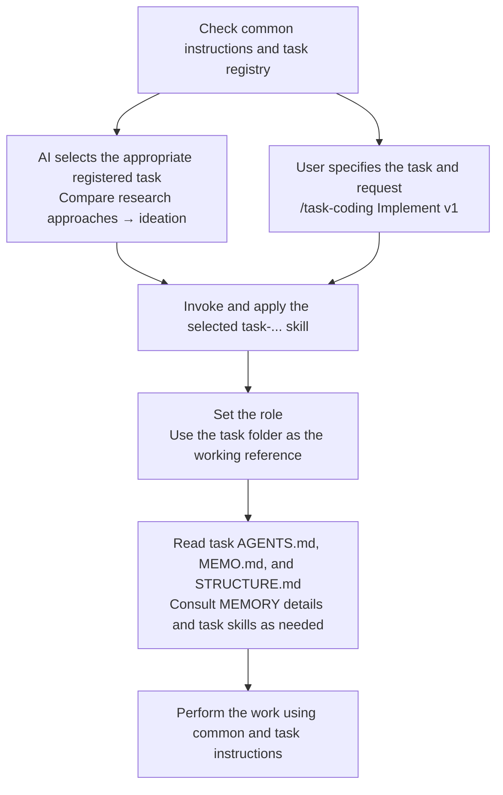

# Multi-task Harness System: Shared and Synchronized Context Across Tasks Toward an Ultimate Goal

**English** | [한국어](README_kr.md)

> **This is a template repository.** To use it for your own research, choose **Use this template** to create your own repository. You get the harness files and folder structure with a single initial commit, without the author's development history. [About repository templates](https://docs.github.com/en/repositories/creating-and-managing-repositories/creating-a-repository-from-a-template)

## Set up your copy of the harness

**From the GitHub website: create your own repository first**

1. Sign in to GitHub and select **Use this template → Create a new repository** on the [source repository](https://github.com/JongHwa-Shim/multi-task-harness-system).
2. Choose your account, a repository name such as `my-research-harness`, and its visibility, then click **Create repository from template**. **Private** is a good option for personal research.
3. In **your new repository**, select **Code → Download ZIP**, download the archive, and extract it.

ZIP downloads do not include `.git`. When you initialize the harness, the helper creates a local harness Git repository. If you also want to back up your work to GitHub, ask the helper to connect it to your repository.

**From the GitHub website: download only the source files**

1. In the [source repository](https://github.com/JongHwa-Shim/multi-task-harness-system), select **Code → Download ZIP**.

**From the terminal**

Install [Git](https://git-scm.com/downloads) and [GitHub CLI (`gh`)](https://cli.github.com/), then run these commands in the directory where you want to create the harness folder.

```sh
gh auth login
gh repo create my-research-harness --template JongHwa-Shim/multi-task-harness-system --private --clone
cd my-research-harness
```

This creates a private repository under your account and clones it into a local folder connected to that repository. Replace `my-research-harness` with your preferred name. To make it public, replace `--private` with `--public`. Skip the first line if you are already signed in. [Command reference](https://cli.github.com/manual/gh_repo_create)

Whichever method you choose, open the downloaded folder in your AI agent and follow [Start with the helper](#start-with-the-helper) below.

---

Even a single research study involves investigation, idea development, implementation, experiments, writing, and review. These tasks rarely move in a straight line: implementation can change the research direction, and writing can reveal the need for another experiment.

This harness is **a working environment that keeps instructions and memory separate for each task while carrying context across tasks**.

- **Give each task its own focus.** ideation, coding, and writing each maintain their own instructions, memory, and materials.
- **Spend less time repeating background.** Agents can look up decisions and evidence from other tasks and carry them into a new chat.
- **Keep track of what has changed.** Track how far a new design has been incorporated into the code, experiments, and paper.

## Start with the helper

Open the folder containing this README and make a request. This folder is the **harness root**.

```text
/harness-helper I want to work on research, implementation, and paper writing together. Walk me through getting started.
```

The helper introduces itself, asks about your purpose and materials, and follows a simple process: **propose a setup → carry out what you approve**. You can also ask it to add or split tasks, create skills, or change the setup as your work develops.

If you already have several tasks underway, **provide their outputs or folder paths and ask the helper to initialize the harness around them.** It reviews the materials, moves or links them as agreed, and sets up the harness so you can continue your existing work.

If you have a question or something you want to do, **ask `/harness-helper`.** It helps with usage questions, new setups, and ways to use the harness, proposing an appropriate approach and helping you carry it out.

The structure and rules may look complicated at first. **You do not need to work out whether a request fits the harness before asking. Say what you want to do, and the harness will handle it or suggest a way forward.**

**You do not need to keep every memory file and folder organized by hand.** Provide your purpose, materials, requests, and important decisions. The agent maintains the setup and records according to the instructions.

| What you provide or decide | What the harness handles |
| --- | --- |
| What you want to work on, your goals, and essential conditions | Propose a task setup; after approval, create folders, instructions, and transition skills |
| Where your materials are and which environment to use | Read and link the materials, incorporating them into the relevant context and skills |
| Feedback on results, decisions, and change requests | Record actions and decisions in MEMORY and MEMO, and update STRUCTURE |
| Approval of setup changes, changes to essential conditions, and backups | Apply approved changes and commit to the requested repository |

Here, automatic maintenance means **the agent updates records as it performs the work**. Routine memory updates within an approved task do not need separate approval each time. You can also ask `/harness-helper` about usage or the current setup. For questions alone, it explains and gives examples without changing files.

## 1. Folder structure and who manages what

An **ultimate goal** is the larger outcome that multiple tasks work together to achieve, such as completing a research study and writing it up as a paper.

A **task** is an ongoing unit of work with its own role, goals, and memory across requests and chats. Each `tasks/{task-name}/` folder is a **task root**, and the top-level folder containing them all is the **harness root**. An individual step within a task, such as editing a file or running an experiment, is an **action**.

The following is **an example after setting up three tasks and their skills**. The harness initially provides three meta skills; you create tasks and additional skills with the helper as needed.

- **[Included]**: Files provided with the harness.
- **[Managed]**: Files and folders that the agent creates and maintains under the agreed setup and instructions. Task instructions and skills follow your creation or change requests; memory and structure records are updated as work progresses.
- **[Materials]**: Files and folders you can freely create and arrange to suit the task. You can create them yourself, bring in existing materials, or ask the agent to make them. You do not need to use the example names.

```text
harness/                                     ← harness root
├── AGENTS.md                                [Included] Common instructions + agent-maintained task registry
├── README.md                                [Included] English user guide
├── README_kr.md                             [Included] Korean user guide
├── .git/                                    [Managed] Harness Git commit history
├── .agents/
│   └── skills/                              Shared location for all skills
│       ├── harness-helper/SKILL.md           [Included] (Meta skill) Usage help, setup, and changes
│       ├── dreaming/SKILL.md                 [Included] (Meta skill) Memory review and reconciliation
│       ├── switch-agent-platform/SKILL.md    [Included] (Meta skill) Agent platform conversion
│       ├── task-ideation/SKILL.md            [Managed] (Task transition skill) Enter ideation
│       ├── task-coding/SKILL.md              [Managed] (Task transition skill) Enter coding
│       ├── task-writing/SKILL.md             [Managed] (Task transition skill) Enter writing
│       └── coding-remote/SKILL.md            [Managed] (Task skill) Remote execution procedures added as needed
└── tasks/
    ├── ideation/                            [Managed] ideation task root
    │   ├── AGENTS.md                        [Managed] Research and hypothesis review instructions
    │   ├── MEMORY.md                        [Managed] Full record of goals, current state, and action history
    │   ├── MEMO.md                          [Managed] Concise summary of the whole MEMORY
    │   ├── STRUCTURE.md                     [Managed] Locations and roles of research files
    │   ├── work/                            [Managed, as needed] Ad hoc checks, visualizations, and reports
    │   ├── results/                         [Managed, as needed] Outputs requested for final consolidation
    │   └── notes/                           [Materials] Example notes on prior work and hypotheses
    ├── coding/                              [Managed] coding task root
    │   ├── AGENTS.md                        [Managed] Implementation, experiment, and validation instructions
    │   ├── MEMORY.md                        [Managed] Full record of goals, experiment state, and action history
    │   ├── MEMO.md                          [Managed] Concise summary of the whole MEMORY
    │   ├── STRUCTURE.md                     [Managed] Locations and roles of code and research files
    │   ├── work/                            [Managed, as needed] Separately requested interim evaluation reports
    │   ├── results/                         [Managed, as needed] Evaluation reports requested for final consolidation
    │   └── codebase/                        [Materials] coding codebase, data, and regular experiment outputs
    └── writing/                             [Managed] writing task root
        ├── AGENTS.md                        [Managed] Writing and evidence-checking instructions
        ├── MEMORY.md                        [Managed] Full record of goals, draft state, and action history
        ├── MEMO.md                          [Managed] Concise summary of the whole MEMORY
        ├── STRUCTURE.md                     [Managed] Locations and roles of drafts and research files
        ├── work/                            [Managed, as needed] Interim reviews and proposed revisions
        ├── results/                         [Managed, as needed] Papers and reports requested for final consolidation
        └── draft.md                         [Materials] Example paper draft in progress
```

`AGENTS.md`, MEMORY, MEMO, and STRUCTURE are prepared when a task is created. **`work/` and `results/` serve the same purposes in every task and are created when there are outputs to save.** You do not need to create empty folders in advance.

Use `work/` for ad hoc checks, visualizations, and separately requested intermediate outputs. Use `results/` for outputs you ask to consolidate and keep as final results. Regular outputs such as model checkpoints and experiment logs follow the storage conventions of the coding task's codebase.

**Skills live at the harness root; task instructions, memory, and research materials live in their respective task roots.** MEMORY, MEMO, and STRUCTURE are not created at the harness root. In the Claude setup, `AGENTS.md` becomes `CLAUDE.md`, and `.agents/` becomes `.claude/`.

You can edit files directly as well. After moving materials or changing the setup, ask: “Check the files I changed and update the related memory and paths.”

## 2. Common instructions and task instructions have different roles

| File | Scope | Examples of its contents |
| --- | --- | --- |
| `AGENTS.md` at the harness root | All tasks | Preserve essential conditions; select and delegate tasks; manage memory, terminology, and the task registry |
| `tasks/ideation/AGENTS.md` | ideation | How to compare prior work and distinguish hypotheses from evidence |
| `tasks/coding/AGENTS.md` | coding | Implementation approach, experiment conditions, and validation procedures |
| `tasks/writing/AGENTS.md` | writing | Paper structure, checking claims and citations, and writing conventions |

The agent **applies the common instructions together with the current task's instructions**. For example, coding follows the common rule to preserve essential conditions while using the experiment procedures defined in its own instructions.

Progress is recorded in MEMORY and MEMO rather than continually added to instruction files. Referring to another task's materials does not make all of that task's specific rules apply to the current task.

## 3. Selecting and switching tasks: let the AI choose or specify one yourself

**A task transition skill, `task-{task-name}`, specifies the AI agent's role, its task root, and the instructions and memory it needs to read.**

For example, applying `task-coding` gives the agent the coding role and makes **`tasks/coding/` its task root: the reference point for carrying out the work**. It uses that base to determine where to find and create files or run commands, working inside the codebase below it when appropriate.

On entry, the agent first checks the common instructions and task registry at the harness root, then reads `AGENTS.md`, `MEMO.md`, and `STRUCTURE.md` in the task root. It applies both sets of instructions, consulting MEMORY for details and the relevant task skills for specialized procedures.

There are two ways to select a task.

| Method | Example request | What the agent does |
| --- | --- | --- |
| **The AI chooses** | In a new chat: “Compare research approaches for floor plan generation.” | Determines that ideation is the appropriate registered task, then invokes `/task-ideation` to enter it |
| **You specify the task** | `/task-coding Implement the adopted v1 approach.`<br/>Or: “Switch to coding now and implement v1.” | Applies `task-coding` and starts implementation using coding's task root, instructions, and memory |

**Whether the AI chooses or you specify the task, the same transition skill establishes the role and context.** You can enter the skill name together with your request, or describe the desired task and work in ordinary language.



### 3.1. In an ongoing chat

Once a main task is selected, it stays active for follow-up requests. The table below compares **independent situations**, not consecutive steps. Section 6.1 shows a complete sequence.

| Situation | Example request | How it is handled |
| --- | --- | --- |
| Follow-up within the same task | During ideation: “Let's look more closely at the second candidate.” | Continue with the existing instructions and context; no need to invoke the transition skill again |
| Temporary delegation to another task | During ideation: “Just assess whether this approach is feasible to implement.” | A coding subagent applies `task-coding` and reviews feasibility; ideation remains the main task |
| Change the main task | `/task-coding Implement the adopted approach.` Or: “Switch to coding now and start implementation.” | The main agent applies `task-coding` and switches to coding |
| A request spanning several tasks | “Review the research findings, implement the approach, and write a paper draft.” | Task subagents apply their respective transition skills and work in dependency order; the main agent coordinates and integrates |

The AI selects the appropriate transition skill when choosing an initial task or delegating work to another task. **A request of a different kind does not automatically change the main task.** Explicitly request a transition when you want to change it. If the appropriate task is unclear, the agent asks. If a task does not exist yet, the helper proposes how to create it.

**A task skill, `{task-name}-{skill-name}`, defines a procedure specific to that task.** For example, enter the coding role with `task-coding`, then use `coding-remote` to work with a remote machine. Invoking a task skill or a meta skill alone does not change the main task.

## 4. Keep memory per task and share the context you need

### 4.1. Memory files and context from other tasks

| File | What does it contain? | When is it read? |
| --- | --- | --- |
| `MEMORY.md` | The full record: long-term goals, conditions and decisions; current state and unresolved issues; chronological action history | When detailed reasoning, past context, or evidence is needed |
| `MEMO.md` | A balanced summary of goals, current state, and important history from the whole MEMORY | By default when starting, resuming, or switching to a task |
| `STRUCTURE.md` | Paths and roles of actual research files, excluding harness management files | By default when starting, resuming, or switching to a task, and later when file locations are needed |

MEMO is not limited to short-term memory. It is **a summary for resuming work that covers overall goals, important history, and what to do next**. The agent records meaningful changes in MEMORY with timestamps, reasons, and evidence, and updates MEMO as well. Summarizing does not remove the detailed records.

Other tasks start with the relevant MEMO and STRUCTURE, then look up details and evidence in MEMORY and the original sources. The task that produced a result manages the original; a task using it records **which version it actually incorporated**.

### 4.2. Use Git history to recover changes that memory does not explain

MEMORY explains decisions and the current state. **Harness Git lets you inspect the versions of files saved in commits and what changed between them.** When memory and actual files disagree, or context is missing during a handoff, the agent examines branches, commit history, and file diffs.

For example, if coding used a different research design from the current one in ideation, the agent can read memory and the original sources, then use Git history to determine **which files changed, and how, since the version coding last used**.

| Repository | Example location | What it tracks and backs up |
| --- | --- | --- |
| **Harness Git** | `<harness-root>/.git/` | Versions of tracked common and task instructions, skills, memory, and research documents, including changes across tasks |
| **Project Git** | `tasks/coding/codebase/.git/` | **The separate Git repository for the coding task's codebase**, including implementation and experiment configurations |

The two repositories are managed separately. A harness backup does not also commit or push the coding codebase's separate Git repository.

```text
/task-coding The research design I was implementing seems different from the current records.
Check ideation's memory and the harness Git history, and tell me what changed first. Do not edit anything yet.
```

Request a backup when you want to save changes in Git.

```text
Commit all harness changes so far to harness Git.
```

You can request a backup or accept the agent's suggestion. After meaningful results, the agent summarizes the changes and proposes a commit message. **History is inspected as needed, commits require a request or approval, and remote pushes require an explicit request.** If the intended repository is unclear, the agent asks.

Git history covers committed files. Backing up research decisions and outputs at meaningful milestones makes task transitions and context recovery easier.

### 4.3. Dreaming: check memory against the actual materials

**Use dreaming after a long stretch of work has accumulated materials and records, or when you notice inconsistent or contradictory memory.** It is also useful as a periodic review at milestones or before resuming an older task. The agent may suggest it when it finds conflicting or missing records.

You do not need to spell out a long review procedure. **Invoking the skill runs its standard checks and reconciliation; the main choice is whether to cover all tasks or just one.**

To check all tasks and the connections between them:

```text
/dreaming
```

To check only one task:

```text
/dreaming Check only the coding task.
```

Dreaming **checks that memory agrees with actual materials and outputs, fills in missing context, and reconciles outdated records**. It checks MEMORY, MEMO, and STRUCTURE by default and compares other files and history as needed.

| Scope | Files and materials checked | What is checked? |
| --- | --- | --- |
| **Default** | `MEMORY.md` | Whether goals, conditions, decisions, current state, and chronological records match the evidence |
| **Default** | `MEMO.md` | Missing important context, outdated summaries, or unverified statements recorded as confirmed |
| **Default** | `STRUCTURE.md` | Whether the listed paths, file existence, and roles match the actual files |
| **Additional material as needed** | Task instructions, relevant `SKILL.md` files, and supporting documents | Whether records agree with the accepted procedures, conditions, and environment |
| **Additional material as needed** | Research notes, code and configuration, data descriptions, experiment logs and results, and paper drafts | Whether recorded work was actually done, whether claims have supporting evidence, and which result versions were incorporated |
| **Relevant change history** | Git commits and file diffs | File changes, earlier versions, and how changes were incorporated across tasks |

For example, MEMO may say “v2 experiments complete” while the logs and results only support v1. The agent checks the evidence, corrects the status, and leaves v2 validation unresolved. It also checks whether the result version used in the paper matches the memory records. If there is no evidence to determine which conflicting account is correct, it preserves the conflict and asks you.

**Without a specified task, dreaming checks all tasks and their connections**, including the relevant harness instructions, skills, and Git history. A request such as `/dreaming Check only the coding task.` limits even the source inspection to that task. If a skill or material outside that scope is needed, the agent reports the dependency.

**The inspection can cover a broad set of materials, but by default only MEMORY, MEMO, and STRUCTURE are modified.** Problems found in other files are reported as follow-up work. The agent does not change code, data, papers, or research conditions merely to make the records agree. If you ask for findings only and no edits, it leaves the record files unchanged too.

## 5. Management tools to use when needed

These three **meta skills** manage the harness without changing the active task role.

| Skill | Purpose | Example request |
| --- | --- | --- |
| `/harness-helper` | Questions about usage and the current setup; initialization; creating or changing tasks, folders, and skills | Explain the difference between MEMORY and MEMO. / Suggest how to split the writing task. |
| `/dreaming` | Review missing, conflicting, or outdated memory and context across tasks | `/dreaming` or `/dreaming Check only the coding task.` |
| `/switch-agent-platform` | Switch between AGENTS and Claude setups | Switch the harness to the Claude setup. |

Skill names use lowercase letters, digits, and hyphens. Meta skill names are otherwise unrestricted, and their descriptions identify them as meta skills. When creating tasks or skills, or splitting folders, the helper reviews existing materials, proposes changes, and acts after approval.

### 5.1. Getting started with Claude

If `/harness-helper` is not available, ask:

```text
Read and apply .agents/skills/harness-helper/SKILL.md at the harness root.
Start by helping me prepare the harness for Claude.
```

In a harness that has already been converted, the same file is at `.claude/skills/harness-helper/SKILL.md`. Platform conversion moves the instruction files and settings directory. References to old paths inside documents are interpreted as their counterparts in the current platform.

## 6. Practical examples

### 6.1. Research → implementation and experiments → paper writing → revising the research

This is **a fictional sequence for a single floor plan generation study**. Imagine that you already have some research notes, code, and a paper draft, but have to explain the background again whenever you change tasks. The tasks, materials, and results below are illustrative; they have not already been created in the harness.

**1. Organize existing research materials into tasks.**

```text
/harness-helper I want to set up ideation, coding, and writing tasks
using the research notes, code, and paper draft I provided.
Propose a setup that preserves my existing materials and lets each task continue from them.
```

The helper reads the actual materials and proposes where they belong and what to move or share. Once you approve, it creates task folders, instructions, memory, and transition skills, and links your existing materials. You explain the goals and essential conditions and review the proposed setup.

**Why this helps:** You start from the research you have already done, without having to write each task's memory files and transition skill yourself.

**2. Continue the research with an ordinary request.**

In a new chat, ask:

```text
Investigate floor plan generation methods that satisfy adjacency constraints.
Compare the candidates in my existing notes and organize the hypotheses to test next.
```

The agent selects ideation from the registered tasks and invokes `task-ideation`. Using `tasks/ideation/` as its reference point, it reads existing goals, conditions, and notes to compare candidates. After discussion, it records the chosen approach as v1, distinguishing adoption as a research direction from experimental validation.
You can also invoke `/task-ideation` directly.

**Why this helps:** You spend less time choosing a skill name or reconstructing the research background from an earlier chat.

**3. Check implementation feasibility while keeping the research conversation active.**

```text
Have coding review only whether this approach is feasible to implement.
Do not change the code yet. Tell me what would need to change and what constraints to expect.
```

ideation remains the main task. A coding subagent applies `task-coding`, reads the research decisions and relevant code, and returns its review. You can use that review to refine the approach in the same research conversation.

**Why this helps:** There is less need to copy materials between research and implementation yourself, and a brief technical review does not change the main role or context of the chat.

**4. Switch to implementation and experiments.**

```text
/task-coding Implement the adopted v1 approach and run experiments under the agreed conditions.
Keep the existing evaluation conditions and record failure cases too.
```

The main task now becomes coding. The agent reads coding's instructions and memory, then checks the v1 design adopted by ideation and its essential conditions. It connects implementation and experiment records to code, configurations, results, and logs, and records failures and anything that remains unverified.

**Why this helps:** “Implement the earlier research design” points to actual records and a specific version. The agent taking over has less need to guess conditions or repeat failed attempts.

**5. Bring verified results into the paper draft.**

```text
/task-writing Draft the experiments section using the v1 results validated by coding.
Clearly distinguish any results or claims that remain unverified.
```

writing reads coding's memory for an overview, then checks the numbers and validation scope against the original logs and results. The draft records which result version it actually uses.

**Why this helps:** You spend less time collecting and pasting results, and the paper's claims stay connected to experimental evidence.

**6. Revise the research design using the failure cases.**

```text
/task-ideation Let's design v2 based on the failure cases found by coding.
Keep the evaluation conditions and record what changes from v1 and why.
```

ideation reads the failure conditions and evidence and develops v2. At this point, the research design has changed, while the existing code, experiments, and draft may still use v1. Each task retains a record of the version it has actually incorporated.

```text
ideation: v2 design adopted ── pending incorporation ──▶ coding: v1 implementation and experiments
                                                        │ uses v1 results
                                                        ▼
                                                   writing: v1 draft
```

**Why this helps:** Adopting v2 is kept distinct from implementing and validating it. You can see what still needs to be implemented, tested, and rewritten.

**7. Reconcile the accumulated memory and continue.**

```text
/dreaming
```

The agent compares MEMORY, MEMO, and STRUCTURE across all tasks with the relevant sources. If a summary incorrectly says “v2 validation complete,” it checks the evidence and corrects the record, leaving v2 implementation, experiments, and the corresponding paper revisions as outstanding work. When memory alone does not explain a change, it also checks committed Git history.

Backing up to harness Git at meaningful milestones lets you compare those earlier states. In the next chat, the agent can read coding's reconciled memory and resume with the v2 implementation.

**Why this helps:** Even with parallel tasks and repeated revisions, you can resume from a verified current state without manually reconciling every file or re-explaining all the work so far.

### 6.2. Going further: add a remote-machine skill to coding

This example goes beyond task transitions and shared memory to **creating a task skill for your own environment and using a remote machine**. Keep repeatable procedures in the skill and connection and environment details in a supporting document, so later requests can reuse the same procedures and environment.

| Type | Skill in this example | Role |
| --- | --- | --- |
| **Task transition skill** | `task-coding` | Enter the coding role, identify its task root, and read its instructions and memory |
| **Task skill** | `coding-remote` | Check remote machine status and run experiments within the coding task |

`task-coding` establishes the task and context; `coding-remote` supplies a specialized procedure within it. Task skill names follow the `{task-name}-{skill-name}` convention.

**1. Explain the procedures and environment to the helper.**

```text
/harness-helper I want a coding-remote skill for using a remote GPU server within coding.
Propose a setup with status checks and agreed experiment procedures in SKILL.md,
and SSH connection details, remote paths, and environment information in remote-machine.md.
```

**2. Review the proposal and create the skill and supporting document.**

The helper checks the required connection details and the scope of permitted actions. Once you approve the proposal, it creates a structure like this. This is **an example you can add, not a skill included by default**.

```text
.agents/skills/coding-remote/            ← task skill at the harness root
├── SKILL.md                            When and how to perform remote actions
└── remote-machine.md                   Connection and environment details used by the procedures
```

| File | Example contents | What you provide or decide |
| --- | --- | --- |
| `SKILL.md` | Read remote-machine.md; check the connection and environment; inspect status; run experiments; check logs and report failures | Actions to delegate, resource limits, and conditions to check before execution |
| `remote-machine.md` | SSH host alias and account, remote code and data paths, runtime environment, and GPU information | Actual server details and the paths and environment to use |

Keep passwords and private key contents out of these documents; refer to existing local SSH authentication settings. Available connection tools and permissions are checked in the actual environment. The agent can write the files and create the skill, so you do not need to draft both documents yourself.

**3. Switch to coding and use the skill.**

Start with a status check only.

```text
/task-coding Use coding-remote to check only the research server's GPU status and running experiments.
Do not start new experiments or stop existing processes.
```

**4. Run experiments in the environment you checked.**

After reviewing the status and deciding the execution conditions, ask:

```text
Run the experiment in the checked environment with the agreed configuration, and organize the logs and results.
```

The agent uses the transition skill to read coding's instructions and memory, then follows `coding-remote/SKILL.md` with the actual environment information in `remote-machine.md`. Execution is recorded in coding's MEMORY and MEMO; logs and checkpoints follow the codebase's regular storage conventions.

**Why this helps:** You spend less time repeating server access details and execution procedures and can focus on what to run and under which conditions. When the server or environment changes, update the supporting information and keep using the same skill.
