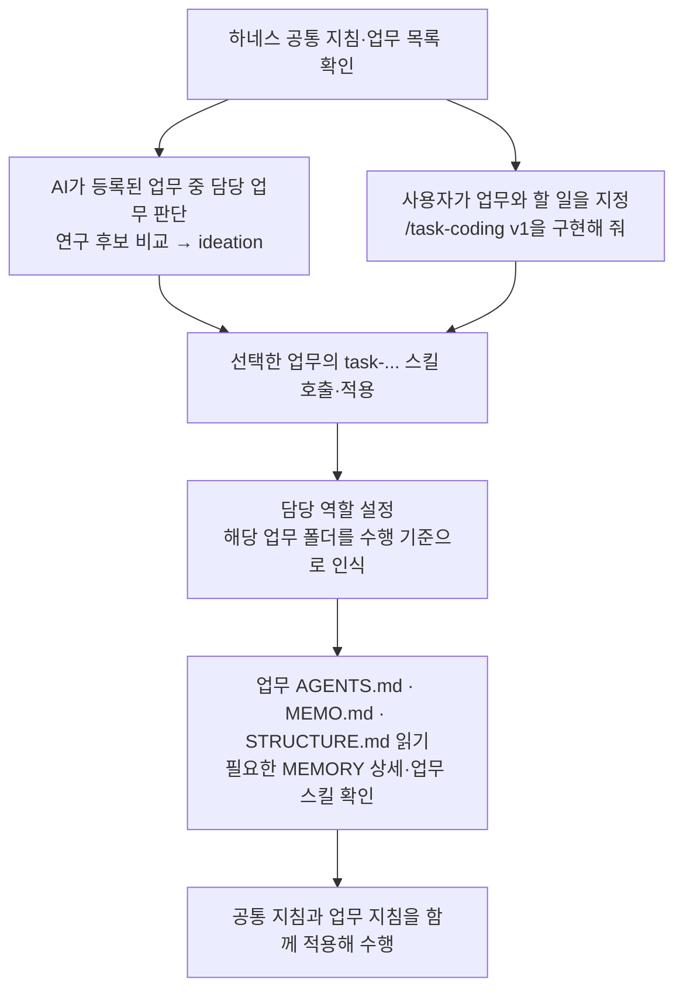

# 멀티태스크 하네스 시스템: 하나의 최종 목표를 위해 업무 간 맥락을 공유하고 맞추는 작업 환경

[English](README.md) | **한국어**

> **이 저장소는 템플릿 저장소입니다.** 개인 연구용으로 가져갈 때는 **Use this template**으로 내 저장소를 만들어 주세요. 하네스 파일·폴더 구성을 가져오고, 개발자의 과거 커밋 이력 없이 초기 커밋 하나로 시작할 수 있습니다. [템플릿 기능 안내](https://docs.github.com/en/repositories/creating-and-managing-repositories/creating-a-repository-from-a-template)

## 하네스 설치하기

**GitHub 화면에서 받기 (Repo로 만든 후 가져오기)**

1. GitHub에 로그인한 뒤 [원본 저장소](https://github.com/JongHwa-Shim/multi-task-harness-system)에서 **Use this template → Create a new repository**를 선택합니다.
2. 본인 계정과 원하는 저장소 이름(예: `my-research-harness`), 공개 범위를 정하고 **Create repository from template**을 누릅니다. 개인 연구용이라면 **Private**으로 시작해도 좋습니다.
3. 생성된 **내 저장소**에서 **Code → Download ZIP**을 눌러 내려받고 압축을 풉니다.

ZIP에는 `.git`이 포함되지 않습니다. 하네스를 초기화할 때 도우미가 로컬 하네스 git을 생성하며, GitHub에도 백업하려면 도우미에게 내 저장소와 연결해 달라고 요청하세요.

**GitHub 화면에서 받기 (소스코드만 다운받기)**

1. [원본 저장소](https://github.com/JongHwa-Shim/multi-task-harness-system)에서 **Code → Download ZIP**을 눌러 내려받고 압축을 풉니다.

**터미널로 받기**

[Git](https://git-scm.com/downloads)과 [GitHub CLI (`gh`)](https://cli.github.com/)를 설치한 뒤, 하네스 폴더를 만들 위치에서 실행하세요.

```sh
gh auth login
gh repo create my-research-harness --template JongHwa-Shim/multi-task-harness-system --private --clone
cd my-research-harness
```

본인 계정에 비공개 저장소를 만들고, 그 저장소에 연결된 로컬 폴더까지 내려받는 명령입니다. `my-research-harness`는 원하는 이름으로 바꾸고, 공개하려면 `--private`을 `--public`으로 바꾸세요. 이미 로그인했다면 첫 줄은 생략해도 됩니다. [명령 안내](https://cli.github.com/manual/gh_repo_create)

어느 방법이든 받은 폴더를 AI 에이전트에서 열고, 아래 [시작은 도우미와 함께](#시작은-도우미와-함께)를 따라 진행하세요.

---

하나의 연구에도 조사, 아이디어 구체화, 구현·실험, 논문 작성과 검토가 필요합니다. 업무는 순서대로만 진행되지 않습니다. 구현 중 발견한 문제로 연구주제가 바뀌고, 논문을 쓰다가 추가 실험이 필요해지기도 합니다.

이 하네스는 **업무별 지침과 기억을 나눠 관리하면서, 업무를 오가도 맥락을 이어 쓰는 작업 환경**입니다.

- **각 업무에 집중합니다.** ideation, coding, writing이 자기 지침·기억·자료를 관리합니다.
- **배경 설명을 줄입니다.** 다른 업무가 남긴 결정과 근거를 직접 찾아 쓰고, 새 채팅에서도 이어갑니다.
- **변경을 따라갑니다.** 새 설계가 코드·실험·논문에 어디까지 반영됐는지 구분합니다.

## 시작은 도우미와 함께

이 README가 있는 폴더를 열고 요청하세요. 이 폴더가 **하네스 루트**입니다.

```text
/harness-helper 연구 조사, 구현, 논문 작성을 함께 진행하고 싶어. 처음부터 안내해 줘.
```

도우미가 자신을 소개하고, 목적과 자료를 확인한 뒤 **구성안을 제안 → 동의받은 내용 실행** 순서로 돕습니다. 사용하는 도중에도 업무 추가·분리, 스킬 생성, 구성 변경을 맡길 수 있습니다.

이미 여러 업무를 진행 중이라면 **산출물 자료나 기존 폴더 경로를 전달하고, 이를 반영해 하네스를 초기화해 달라고 요청하세요.** 도우미가 자료를 확인하고 합의한 방식으로 옮기거나 연결해, 기존 업무를 하네스에서 이어갈 수 있도록 구성합니다.

궁금한 점이나 해 보고 싶은 일이 있다면 **`/harness-helper`에게 무엇이든 편하게 요청하세요.** 사용법 질문부터 새로운 구성과 활용 방법까지, 적절한 방법을 함께 찾고 실행을 돕습니다.

하네스의 작동구조와 규정이 복잡해보일 수 있습니다. **"이런 요청은 괜찮을까?"하고 겁먹지 마세요. 어떤 작업이든 편하게 요청하세요. 하네스가 알아서 자동으로 처리하거나, 최선의 방법을 제안할 것입니다.**

**사용자가 기억 파일과 폴더를 매번 직접 정리할 필요는 없습니다.** 사용자는 목적과 자료, 요청, 중요한 결정을 전달하기만 하면 됩니다. 에이전트가 지침에 따라 구성과 기록을 관리합니다.

| 사용자가 챙길 것 | 하네스가 맡는 일 |
| --- | --- |
| 하려는 업무·목표·핵심 조건을 말하기 | 업무 구성안을 제안하고, 동의 후 폴더·지침·전환 스킬 생성 |
| 실제 자료의 위치와 사용할 환경 알려 주기 | 자료를 읽어 연결하고, 필요한 컨텍스트와 스킬에 반영 |
| 결과를 검토하고 결정·수정 요청 전달하기 | 수행 내용과 결정을 MEMORY·MEMO에 기록하고 STRUCTURE 갱신 |
| 구성 변경안·핵심 조건 변경·백업 여부 결정하기 | 동의받은 변경 적용, 요청한 저장소에 커밋·백업 |

여기서 자동 관리는 **에이전트가 업무를 수행하면서 기록을 갱신한다**는 뜻입니다. 이미 승인된 업무의 일상적인 기억 갱신까지 매번 승인할 필요는 없습니다. 사용법이나 현재 구성이 궁금할 때도 `/harness-helper`에 물어보세요. 단순 질문에는 설명과 예시로 답하며 파일을 변경하지 않습니다.

## 1. 폴더 구조와 관리 담당을 한눈에 보기

**최종 목표(ultimate goal)**는 여러 업무가 함께 이루려는 큰 목적입니다. 예를 들어 한 연구를 완성해 논문으로 정리하는 것입니다.

**업무(task)**는 여러 요청과 채팅에 걸쳐 이어가는 역할·목표·기억의 단위입니다. `tasks/{업무명}/`가 각 **업무 루트**이고, 전체를 묶는 최상위 폴더가 **하네스 루트**입니다. 파일 수정이나 실험 실행 같은 개별 행위는 **작업**이라고 부릅니다.

아래는 **업무 세 개와 전용 스킬을 구성한 뒤의 예시**입니다. 처음에는 메타 스킬 세 개가 제공되고, 업무와 전용 스킬은 필요에 따라 도우미와 만듭니다.

- **[제공]**: 하네스에 기본 포함된 파일입니다.
- **[관리]**: 에이전트가 합의한 구성과 지침에 따라 생성·관리합니다. 업무 지침과 스킬은 생성·변경 요청에 맞추고, 기억과 구조 안내는 업무 진행에 따라 갱신합니다.
- **[자료]**: 업무에 맞게 자유롭게 만들고 배치하는 파일·폴더입니다. 사용자가 직접 만들거나 가져올 수도, 에이전트에게 생성을 맡길 수도 있습니다. 예시의 이름을 따를 필요는 없습니다.

```text
harness/                                     ← 하네스 루트
├── AGENTS.md                                [제공] 공통 지침 + 에이전트가 갱신하는 업무 목록
├── README.md                                [제공] 영어 사용자 안내
├── README_kr.md                             [제공] 한국어 사용자 안내
├── .git/                                    [관리] 하네스 git의 커밋 이력
├── .agents/
│   └── skills/                              모든 스킬의 공통 위치
│       ├── harness-helper/SKILL.md           [제공] (메타 스킬) 사용법 안내·구성 상담·수정
│       ├── dreaming/SKILL.md                 [제공] (메타 스킬) 기억 점검·정리
│       ├── switch-agent-platform/SKILL.md    [제공] (메타 스킬) 플랫폼 구성 전환
│       ├── task-ideation/SKILL.md            [관리] (업무 전환 스킬) ideation 진입
│       ├── task-coding/SKILL.md              [관리] (업무 전환 스킬) coding 진입
│       ├── task-writing/SKILL.md             [관리] (업무 전환 스킬) writing 진입
│       └── coding-remote/SKILL.md            [관리] (업무 스킬) 필요해서 추가한 원격 실행 절차
└── tasks/
    ├── ideation/                            [관리] ideation 업무 루트
    │   ├── AGENTS.md                        [관리] 연구 조사·가설 검토 지침
    │   ├── MEMORY.md                        [관리] 목표·현재 상태·작업 내역의 원본
    │   ├── MEMO.md                          [관리] MEMORY 전체의 짧은 요약
    │   ├── STRUCTURE.md                     [관리] 연구 파일의 위치와 역할
    │   ├── work/                            [관리·필요시] 중간 점검·시각화·보고서
    │   ├── results/                         [관리·필요시] 최종 정리를 요청한 산출물
    │   └── notes/                           [자료] 선행연구·가설 메모의 예
    ├── coding/                              [관리] coding 업무 루트
    │   ├── AGENTS.md                        [관리] 구현·실험·검증 지침
    │   ├── MEMORY.md                        [관리] 목표·실험 상태·작업 내역의 원본
    │   ├── MEMO.md                          [관리] MEMORY 전체의 짧은 요약
    │   ├── STRUCTURE.md                     [관리] 코드·연구 파일의 위치와 역할
    │   ├── work/                            [관리·필요시] 별도로 요청한 중간 평가 보고서
    │   ├── results/                         [관리·필요시] 최종 정리를 요청한 평가 보고서
    │   └── codebase/                        [자료] coding 업무의 코드·데이터·정규 실험 산출물
    └── writing/                             [관리] writing 업무 루트
        ├── AGENTS.md                        [관리] 논문 작성·근거 확인 지침
        ├── MEMORY.md                        [관리] 목표·초안 상태·작업 내역의 원본
        ├── MEMO.md                          [관리] MEMORY 전체의 짧은 요약
        ├── STRUCTURE.md                     [관리] 초안·연구 파일의 위치와 역할
        ├── work/                            [관리·필요시] 중간 검토·수정안
        ├── results/                         [관리·필요시] 최종 정리를 요청한 논문·보고서
        └── draft.md                         [자료] 작성 중인 논문 초안의 예
```

`AGENTS.md`·MEMORY·MEMO·STRUCTURE는 업무를 만들 때 함께 준비합니다. **`work/`와 `results/`는 모든 업무에서 같은 용도로 사용하며, 실제 산출물을 저장할 때 생성합니다.** 아직 없어도 사용자가 빈 폴더를 미리 만들 필요는 없습니다.

`work/`는 일시적인 점검·시각화나 별도로 요청한 중간 결과, `results/`는 사용자가 최종 정리·보관을 요청한 결과를 둡니다. 모델 체크포인트·실험 로그 등 정규 산출물은 coding 업무 코드베이스의 저장 방식을 따릅니다.

**스킬은 하네스 루트에, 업무별 지침·기억·연구 자료는 각 업무 루트에 둡니다.** 하네스 루트에는 MEMORY·MEMO·STRUCTURE를 만들지 않습니다. Claude 구성에서는 `AGENTS.md`가 `CLAUDE.md`로, `.agents/`가 `.claude/`로 바뀝니다.

직접 파일을 편집하는 것도 가능합니다. 자료를 옮기거나 구성을 바꿨다면 “변경한 파일을 확인하고 관련 기억과 경로를 맞춰 줘”라고 요청하면 됩니다.

## 2. 공통 지침과 업무 지침은 역할이 다릅니다

| 파일 | 적용 범위 | 담는 내용의 예 |
| --- | --- | --- |
| 하네스 루트의 `AGENTS.md` | 모든 업무 | 핵심 조건 보존, 업무 선택·위임, 기억 관리, 용어, 업무 목록 |
| `tasks/ideation/AGENTS.md` | ideation | 선행연구 비교 방법, 가설과 근거의 구분 |
| `tasks/coding/AGENTS.md` | coding | 구현 방식, 실험 조건, 검증 절차 |
| `tasks/writing/AGENTS.md` | writing | 논문 구성, 주장·인용 확인, 작성 형식 |

에이전트는 **공통 지침과 현재 업무의 세부 지침을 함께 적용**합니다. 예를 들어 coding은 공통의 “핵심 조건을 임의로 바꾸지 않는다”는 원칙을 따르면서, coding 지침에 정한 실험 절차를 수행합니다.

진행 상황은 지침 파일에 계속 쌓지 않고 MEMORY·MEMO에 기록합니다. 다른 업무의 자료를 참고한다고 그 업무의 전용 규칙까지 현재 업무 전체에 적용하지는 않습니다.

## 3. 업무 선택과 전환: AI에게 맡기거나 직접 지정하기

**업무 전환 스킬 `task-{업무명}`은 AI 에이전트가 맡을 역할과 업무 수행의 기준 폴더, 읽을 지침·기억을 정하는 스킬입니다.**

예를 들어 `task-coding`을 적용하면 에이전트는 coding 담당이 되고, **`tasks/coding/`을 업무 수행의 기준인 업무 루트로 인식**합니다. 파일을 찾고 만들거나 명령을 실행할 대상 경로를 이 기준에서 정하며, 필요한 경우 그 아래 코드베이스에서 작업합니다.

진입할 때는 하네스 루트의 공통 지침·업무 목록을 먼저 확인하고, 업무 루트의 `AGENTS.md`·`MEMO.md`·`STRUCTURE.md`를 읽습니다. 공통 원칙과 해당 업무의 세부 지침을 함께 적용하고, 상세 맥락은 MEMORY에서, 전용 절차는 필요한 업무 스킬에서 확인합니다.

업무를 정하는 방법은 두 가지입니다.

| 방법 | 요청 예시 | 에이전트가 하는 일 |
| --- | --- | --- |
| **AI가 판단해 선택** | 새 채팅에서 “평면도 생성 연구 후보를 비교해 줘.” | 등록된 업무 중 ideation이 담당할 요청이라고 자율적으로 판단한 뒤, `/task-ideation` 업무 전환 스킬을 자율 호출하여 해당 업무로 진입 |
| **사용자가 직접 지정** | `/task-coding 채택한 v1을 구현해 줘.`<br/>또는 “이제 coding 업무로 전환해서 v1을 구현해 줘.” | 요청에 지정된 `task-coding`을 적용하고, coding의 업무 루트·지침·기억을 기준으로 구현 시작 |

**AI가 선택하든 사용자가 지정하든, 선택한 업무의 전환 스킬을 통해 역할과 맥락을 갖춘다는 흐름은 같습니다.** 사용자는 스킬명과 수행할 요청을 함께 적거나, 자연어로 원하는 업무와 할 일을 말하면 됩니다.



### 3.1. 이미 진행 중인 채팅에서는

한 번 정한 메인 업무는 후속 요청에도 유지합니다. 아래 표는 **서로 독립적인 요청 상황을 비교**한 것입니다. 순서대로 이어지는 실제 사용 흐름은 6.1절에서 보여 드립니다.

| 상황 유형 | 요청 예시 | 처리 방식 |
| --- | --- | --- |
| 같은 업무의 후속 요청 | ideation에서 “두 번째 후보를 더 살펴보자.” | 기존 지침·맥락을 이어서 사용. 전환 스킬을 다시 부를 필요 없음 |
| 타 업무에 일시적으로 위임 | ideation에서 “이 방법의 구현 가능성만 검토해 줘.” | coding subagent가 `task-coding`을 적용해 검토. 메인 업무는 ideation 유지 |
| 메인 업무 변경 | `/task-coding 채택한 방법을 구현해 줘.` 또는 “이제 coding으로 전환해서 구현하자.” | 메인 에이전트가 `task-coding`을 적용하고 coding으로 전환 |
| 여러 업무가 섞인 요청 | “조사 결과를 검토하고, 구현한 뒤 논문 초안까지 작성해 줘.” | 업무별 subagent가 각 전환 스킬을 적용하고 선후관계에 맞춰 수행. 메인은 조율·통합 |

AI는 처음 담당 업무를 고르거나 필요한 타 업무를 위임할 때 적절한 전환 스킬을 판단해 적용합니다. **다른 종류의 요청이 들어왔다고 메인 업무를 매번 바꾸지는 않습니다.** 메인 업무를 바꾸려면 전환을 명시하세요. 담당 업무가 모호하면 질문하고, 아직 없는 업무가 필요하면 도우미와 생성안을 정합니다.

**업무 스킬 `{업무명}-{스킬명}`은 해당 업무의 전용 절차**입니다. `task-coding`으로 coding 역할에 진입한 뒤 `coding-remote`로 원격 머신을 사용하는 식입니다. 업무 스킬이나 메타 스킬 호출만으로 메인 업무가 바뀌지는 않습니다.

## 4. 기억은 업무별로, 필요한 맥락은 서로 공유합니다

### 4.1. 기억 파일과 다른 업무의 맥락 읽기

| 파일 | 무엇을 담나요? | 언제 읽나요? |
| --- | --- | --- |
| `MEMORY.md` | 장기 목표·조건·결정, 현재 상태·미해결 문제, 시간순 작업 내역의 원본 | 상세 이유·과거 맥락·근거가 필요할 때 |
| `MEMO.md` | MEMORY 전체에서 목표·현재 상태·주요 이력을 고르게 압축한 요약 | 업무 시작·재개·전환 시 기본으로 |
| `STRUCTURE.md` | 실제 연구 파일의 경로와 역할. 하네스 운영 파일은 제외 | 업무 시작·재개·전환 시 기본으로, 이후 파일 위치 확인이 필요할 때 |

MEMO는 단기기억 전용 파일이 아닙니다. **전체 목표와 주요 이력, 지금 할 일까지 함께 담은 재개용 요약**입니다. 에이전트가 의미 있는 변경을 MEMORY에 시각·이유·근거와 함께 기록하고 MEMO도 갱신합니다. 상세 기록을 요약 때문에 지우지는 않습니다.

다른 업무는 필요한 MEMO·STRUCTURE부터 살펴보고, MEMORY와 원본에서 세부 근거를 찾습니다. 결과 원본은 만든 업무가 관리하고, 사용하는 업무는 **어떤 버전을 실제로 반영했는지** 남깁니다.

### 4.2. 기억에 없는 변경 경위는 Git 이력에서 찾습니다

MEMORY는 결정의 이유와 현재 상태를 설명하고, **하네스 git은 커밋에 저장된 파일의 당시 버전과 변경 내용을 확인하게 해 줍니다.** 에이전트는 기억과 실제 파일이 어긋나거나 업무를 이어받는 데 필요한 맥락이 부족하면 브랜치·커밋 이력·파일 차이를 조회합니다.

예를 들어 coding이 사용하던 연구안과 현재 ideation의 연구안이 다르면, 기억과 원본을 읽고 **마지막으로 사용한 버전 이후 어떤 파일이 어떻게 바뀌었는지** Git 이력으로 확인할 수 있습니다.

| 구분 | 저장소 위치의 예 | 확인·백업하는 내용 |
| --- | --- | --- |
| **하네스 git** | `<하네스 루트>/.git/` | Git에 등록한 공통·업무 지침, 스킬, 기억, 연구 문서 등의 버전과 업무 간 변경 흐름 |
| **프로젝트 git** | `tasks/coding/codebase/.git/` | **coding 업무의 코드베이스에 별도로 둔 Git**. 구현·실험 설정 등 해당 코드베이스의 버전 |

두 저장소는 각각 관리합니다. 하네스 백업에 coding 코드베이스의 별도 Git 백업·푸시까지 포함되는 것으로 취급하지 않습니다.

```text
/task-coding 이전에 구현하던 연구안과 현재 기록이 다른 것 같아.
ideation의 기억과 하네스 git 이력을 확인해서 변경된 부분부터 알려 줘. 아직 수정하지 마.
```

변경을 백업하고 싶을 때는 별도로 요청합니다.

```text
현재까지의 하네스 변경을 하네스 git에 커밋해 줘.
```

사용자는 백업할 시점에 요청하거나 에이전트의 백업 제안에 동의하면 됩니다. 에이전트는 의미 있는 결과가 나오면 변경 요약과 추천 커밋 메시지를 제시합니다. **이력 조회는 필요에 따라 수행하고, 커밋은 요청·동의 후, 원격 푸시는 명시적인 요청 후 진행합니다.** 어느 저장소를 뜻하는지 불명확하면 확인합니다.

Git 이력은 커밋된 파일을 기준으로 하므로, 다시 참조할 연구 결정이나 산출물이 정리된 시점에 백업해 두면 업무 전환과 맥락 복구에 도움이 됩니다.

### 4.3. Dreaming으로 기억과 실제 자료를 함께 점검하기

**업무를 오래 진행해 자료와 기록이 쌓였을 때, 또는 기억의 불일치·모순이 느껴질 때 사용하세요.** 큰 단계를 마치거나 오래된 업무를 다시 이어가기 전에 주기적으로 정리하는 데도 유용합니다. 에이전트가 기록의 충돌이나 누락을 발견하면 실행을 제안할 수도 있습니다.

세부 점검 절차를 길게 설명할 필요는 없습니다. **스킬을 호출하면 기본 점검·정리를 수행하며, 주로 정할 것은 전체 업무를 볼지 특정 업무만 볼지입니다.**

전체 업무와 업무 간 연결을 점검하려면:

```text
/dreaming
```

특정 업무 내부만 점검하려면:

```text
/dreaming coding 업무만 점검해 줘.
```

Dreaming은 **기억과 실제 자료·산출물의 일치성을 확인하고, 빠진 맥락과 오래된 기록을 정리하는 과정**입니다. MEMORY·MEMO·STRUCTURE를 기본으로 점검하며, 필요한 다른 파일과 이력도 함께 대조합니다.

| 구분 | 점검하는 파일·자료 | 무엇을 확인하나요? |
| --- | --- | --- |
| **기본** | `MEMORY.md` | 목표·조건·결정·현재 상태·시간순 내역이 근거와 맞는지 |
| **기본** | `MEMO.md` | 중요한 맥락이 빠졌거나, 원기록보다 오래됐거나, 미검증 내용을 확정해 적었는지 |
| **기본** | `STRUCTURE.md` | 실제 파일의 위치·존재·역할과 안내가 일치하는지 |
| **필요한 추가 자료** | 업무 지침, 관련 `SKILL.md`와 보조 문서 | 합의한 절차·조건·환경 정보와 기록의 일치 여부 |
| **필요한 추가 자료** | 연구 노트, 코드·설정, 데이터 설명, 실험 로그·결과, 논문 초안 | 기록한 작업을 실제 수행했는지, 주장에 근거가 있는지, 어느 결과 버전을 반영했는지 |
| **필요한 변경 이력** | 관련 Git 커밋·파일 차이 | 커밋별 파일 변경·이전 판본·업무 간 반영 흐름 |

예를 들어 MEMO에는 “v2 실험 완료”라고 적혔지만 로그·결과가 v1만 뒷받침하면, 근거를 확인해 상태를 바로잡고 v2 검증을 미해결로 남깁니다. 논문이 사용하는 결과 버전과 기억의 기록이 다른지도 대조합니다. 어느 쪽이 맞는지 판단할 근거가 없으면 충돌을 보존하고 사용자에게 확인합니다.

**업무를 지정하지 않으면 전체 업무와 업무 간 연결을 점검**하고, 필요한 하네스 지침·스킬·Git 이력까지 살핍니다. `/dreaming coding 업무만 점검해 줘`처럼 지정하면 자료 조사도 해당 업무 내부로 제한합니다. 범위 밖의 스킬이나 자료가 필요하면 그 의존성을 알립니다.

**점검 자료는 폭넓게 확인하되, 기본적으로 수정하는 파일은 MEMORY·MEMO·STRUCTURE입니다.** 다른 파일에서 발견한 문제는 후속 조치로 보고합니다. 기록을 맞추려고 코드·데이터·논문이나 연구 조건을 임의로 바꾸지 않습니다. “수정하지 말고 점검 결과만 알려 줘”라고 요청하면 기록 파일도 수정하지 않습니다.

## 5. 필요할 때 쓰는 관리 도구

다음 세 개는 **메타 스킬**입니다. 업무 역할을 바꾸지 않고 하네스를 관리합니다.

| 스킬 | 용도 | 요청 예시 |
| --- | --- | --- |
| `/harness-helper` | 사용법·현재 구성 질의응답, 초기화, 업무·폴더·스킬 생성과 수정 | MEMORY와 MEMO의 차이를 설명해 줘. / writing 업무를 나누는 방법을 제안해 줘. |
| `/dreaming` | 기억의 누락·충돌·오래된 상태와 업무 간 맥락 점검 | `/dreaming` 또는 `/dreaming coding 업무만 점검해 줘.` |
| `/switch-agent-platform` | AGENTS ↔ Claude 운영 구성 전환 | Claude 구성으로 바꿔 줘. |

스킬 이름은 소문자·숫자·하이픈을 쓰며, 메타 스킬은 자유 이름과 description의 “이 스킬은 메타 스킬이다.”라는 안내로 구분합니다. 업무·스킬 생성이나 폴더 분리는 도우미가 현재 자료를 확인해 변경안을 먼저 제시하고 동의 후 실행합니다.

### 5.1. Claude에서 처음 시작한다면

`/harness-helper`가 보이지 않으면 아래처럼 요청하세요.

```text
하네스 루트의 .agents/skills/harness-helper/SKILL.md를 직접 읽고 적용해 줘.
Claude 구성으로 준비하는 것부터 안내해 줘.
```

이미 전환한 하네스에서는 같은 파일이 `.claude/skills/harness-helper/SKILL.md`에 있습니다. 플랫폼 전환은 지침 파일과 설정 폴더를 옮기며, 본문에 남은 이전 경로 표기는 현재 플랫폼에서 같은 역할의 경로로 해석합니다.

## 6. 실제 활용 예시

### 6.1. 연구 조사 → 구현·실험 → 논문 작성 → 연구 수정 이어가기

다음은 **하나의 평면도 생성 연구를 순서대로 진행하는 가상 예시**입니다. 조사 노트, 기존 코드, 논문 초안이 이미 조금씩 쌓여 있고, 업무를 오갈 때마다 배경을 다시 설명하는 상황에서 시작합니다. 예시의 업무·자료·결과는 실제로 생성된 상태를 뜻하지 않습니다.

**1. 흩어진 연구 자료로 업무 공간을 구성합니다.**

```text
/harness-helper 제공한 조사 노트와 코드, 논문 초안을 바탕으로
ideation·coding·writing 업무를 구성하고 싶어.
기존 자료를 유지하면서 각 업무에서 이어갈 수 있는 구성을 제안해 줘.
```

도우미는 실제 자료를 읽고 어떤 업무에 둘지, 무엇을 옮기거나 공유할지 제안합니다. 동의하면 업무 폴더·지침·기억·전환 스킬을 만들고 기존 자료를 연결합니다. 사용자는 목표와 핵심 조건을 설명하고 구성을 확인하면 됩니다.

**여기서의 장점:** 이미 해 온 연구를 활용해 시작하며, 사용자가 업무별 기억 파일과 전환 스킬을 하나씩 작성할 필요가 없습니다.

**2. 자연어 요청으로 연구 조사를 이어갑니다.**

새 채팅에서 다음처럼 요청합니다.

```text
인접 조건을 잘 지키는 평면도 생성 방법을 조사해 줘.
기존 노트의 후보들을 비교하고, 다음에 검증할 가설을 정리해 줘.
```

에이전트가 등록된 업무 중 적절하다고 판단되는 ideation을 선택하고 `task-ideation`을 호출합니다. `tasks/ideation/`을 기준으로 기존 목표·조건·노트를 읽어 후보를 비교합니다. 논의를 거쳐 선택한 방법을 v1으로 기록하되, 연구 방향으로 채택한 상태와 실험으로 검증한 상태를 구분합니다.
직접 `/task-ideation`을 호출해도 괜찮습니다.

**여기서의 장점:** 사용자가 스킬 이름을 먼저 고르거나, 이전 채팅의 연구 배경을 다시 정리해서 전달할 부담이 줄어듭니다.

**3. 연구 대화를 유지하면서 구현 가능성만 확인합니다.**

```text
이 방법의 구현 가능성만 coding에서 검토해 줘.
코드는 아직 수정하지 말고, 필요한 변경과 예상 제약을 알려 줘.
```

메인 업무는 ideation으로 유지합니다. coding subagent가 `task-coding`을 적용하고 연구 결정과 기존 코드의 필요한 부분을 읽어 검토 결과를 돌려줍니다. 사용자는 그 결과를 보며 같은 연구 대화에서 방법을 더 다듬을 수 있습니다.

**여기서의 장점:** 조사와 구현 사이에서 자료를 직접 복사해 전달할 필요가 줄고, 잠깐의 기술 검토 때문에 현재 대화의 역할과 맥락이 바뀌지 않습니다.

**4. 구현·실험 업무로 전환합니다.**

```text
/task-coding 채택한 v1을 구현하고 합의한 조건으로 실험해 줘.
기존 평가 조건을 유지하고 실패 사례도 기록해 줘.
```

이제 메인 업무가 coding으로 바뀝니다. 에이전트는 coding의 지침·기억을 읽고 ideation에서 채택한 v1과 핵심 조건을 확인합니다. 수행한 구현과 실험을 코드·설정·결과·로그에 연결하고, 실패와 아직 검증하지 못한 부분도 기억에 남깁니다.

**여기서의 장점:** “이전 연구안대로 구현해 줘”의 기준이 실제 기록과 버전으로 연결됩니다. 새로 맡은 에이전트가 조건을 추측하거나 실패한 시도를 반복하는 일을 줄일 수 있습니다.

**5. 검증한 결과를 논문 초안에 연결합니다.**

```text
/task-writing coding에서 검증한 v1 결과로 실험 절 초안을 써 줘.
확인하지 않은 결과나 주장도 구분해 줘.
```

writing은 coding의 기억으로 실험 개요를 파악하고, 로그·결과 원본에서 수치와 확인 범위를 대조합니다. 초안에는 실제로 사용한 결과 버전을 남깁니다.

**여기서의 장점:** 사용자가 결과를 다시 모아 붙여 넣는 수고를 줄이고, 논문의 주장과 실제 실험 근거를 연결할 수 있습니다.

**6. 실패 사례를 보고 연구 설계를 수정합니다.**

```text
/task-ideation coding에서 확인한 실패 사례를 반영해 v2 설계를 만들자.
평가 조건은 유지하고, v1에서 무엇을 왜 바꾸는지 기록해 줘.
```

ideation은 실패의 조건과 근거를 읽어 v2를 정리합니다. 이 시점에 바뀐 것은 연구 설계이며, 기존 코드·실험·초안은 아직 v1일 수 있습니다. 각 업무는 자신이 실제로 반영한 버전을 유지합니다.

```text
ideation: v2 설계 채택 ── 반영 대기 ──▶ coding: v1 구현·실험
                                         │ v1 결과 사용
                                         ▼
                                    writing: v1 초안
```

**여기서의 장점:** “v2를 채택했다”는 결정을 “v2 구현과 검증까지 끝났다”로 혼동하지 않습니다. 무엇을 다시 구현·실험·작성해야 하는지 드러납니다.

**7. 쌓인 기억을 정리하고 다음 단계로 이어갑니다.**

```text
/dreaming
```

전체 업무의 MEMORY·MEMO·STRUCTURE와 필요한 원본을 대조합니다. 예를 들어 요약에만 “v2 검증 완료”라고 잘못 적혀 있다면 실제 근거를 확인해 정정하고, v2 구현·실험과 후속 논문 수정을 남은 일로 정리합니다. 변경 경위가 기억만으로 분명하지 않으면 커밋된 Git 이력도 확인합니다.

의미 있는 단계에서 하네스 git에 백업해 두면 당시 상태를 다시 비교할 수 있습니다. 다음 채팅에서는 coding의 정리된 기억을 읽고 v2 구현부터 이어갈 수 있습니다.

**여기서의 장점:** 업무가 병행되고 여러 번 수정돼도, 사용자가 모든 파일을 직접 맞추거나 전체 진행 상황을 다시 설명하지 않고 확인된 현재 상태에서 재개할 수 있습니다.

### 6.2. 응용: coding 업무에 원격 머신 스킬 추가하기

이 예시는 기본적인 업무 전환·기억 공유에서 더 나아가, **사용자 환경에 맞춘 업무 스킬을 만들고 원격 머신 활용까지 확장하는 과정**입니다. 반복 절차는 스킬에, 접속·환경 정보는 보조 문서에 나눠 두면 이후 요청에서도 같은 절차와 환경을 이어 쓸 수 있습니다.

| 종류 | 이 예시의 스킬 | 역할 |
| --- | --- | --- |
| **업무 전환 스킬** | `task-coding` | coding 담당 역할로 전환하고 업무 루트·지침·기억을 읽게 함 |
| **업무 스킬** | `coding-remote` | coding 업무 안에서 원격 머신의 상태 조회·실험 실행 절차를 수행 |

`task-coding`이 수행할 업무와 맥락을 정하면, `coding-remote`가 그 안에서 필요한 전용 절차를 맡습니다. 업무 스킬 이름은 `{업무명}-{스킬명}` 규칙을 따릅니다.

**1. 필요한 절차와 환경을 도우미에게 설명합니다.**

```text
/harness-helper coding에서 원격 GPU 서버를 사용할 coding-remote 스킬을 만들고 싶어.
서버 상태 조회와 합의한 실험 실행 절차는 SKILL.md에,
SSH 접속 정보와 원격 경로·환경 정보는 remote-machine.md에 나눠 담는 구성을 제안해 줘.
```

**2. 구성안을 확인하고 스킬과 보조 문서를 만듭니다.**

도우미는 필요한 접속 정보와 허용할 작업 범위를 확인하고, 제안에 동의하면 다음과 같이 구성합니다. 아래는 **추가로 만들 수 있는 예시이며, 기본 제공되는 스킬은 아닙니다.**

```text
.agents/skills/coding-remote/            ← 하네스 루트의 업무 스킬
├── SKILL.md                            언제·어떤 절차로 원격 작업을 수행할지
└── remote-machine.md                   해당 절차가 참조할 접속·환경 정보
```

| 파일 | 담을 내용의 예 | 사용자가 제공·결정할 내용 |
| --- | --- | --- |
| `SKILL.md` | remote-machine.md 읽기, 접속·환경 확인, 상태 조회와 실험 실행 절차, 로그 확인·실패 보고 | 맡길 작업, 자원 한도, 실행 전에 확인할 조건 |
| `remote-machine.md` | SSH 접속 별칭·계정, 원격 코드·데이터 경로, 실행 환경과 GPU 정보 | 실제 서버 정보와 사용할 경로·환경 |

비밀번호·개인키 본문은 이 문서에 넣지 않고 기존 로컬 SSH 인증 설정을 참조합니다. 원격 접속 도구와 권한은 실제 사용 환경에서 확인합니다. 파일 작성과 스킬 생성은 에이전트가 맡을 수 있으므로, 사용자가 두 문서를 처음부터 직접 작성할 필요는 없습니다.

**3. coding으로 전환하면서 만든 스킬을 사용합니다.**

먼저 상태 조회만 요청할 수 있습니다.

```text
/task-coding coding-remote로 연구용 서버의 GPU 상태와 실행 중인 실험만 확인해 줘.
새 실험을 시작하거나 기존 프로세스를 중단하지는 마.
```

**4. 확인한 환경에서 실제 실험으로 이어갑니다.**

조회 결과를 확인하고 실행 조건을 정한 뒤에는 다음처럼 요청합니다.

```text
확인한 환경에서 합의한 설정으로 실험을 실행하고, 로그와 결과를 정리해 줘.
```

에이전트는 업무 전환 스킬로 coding의 지침·기억을 읽고, `coding-remote/SKILL.md`가 안내하는 절차와 `remote-machine.md`의 실제 환경 정보를 적용합니다. 실행 기록은 coding의 MEMORY·MEMO에 남기고, 로그·체크포인트는 코드베이스의 정규 위치를 따릅니다.

**여기서의 장점:** 서버 접속 방법과 실행 절차를 매번 설명할 필요가 줄고, 사용자는 실행할 일과 조건에 집중할 수 있습니다. 서버나 환경이 바뀌면 해당 정보를 갱신해 같은 스킬을 계속 활용합니다.
